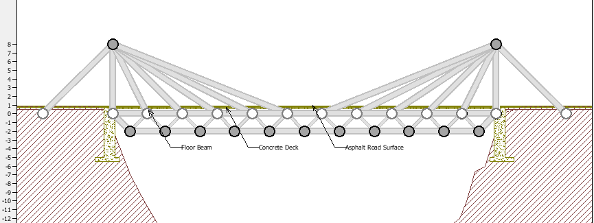

:date: 2026-11-07
:modified: 2026-11-07
:author: Carlos Félix Pardo Martín
:license: Creative Commons Attribution-ShareAlike 4.0 International
:license_url: https://creativecommons.org/licenses/by-sa/4.0/

.. _estructuras-bridge-07:

Ejercicio Warren suspendido doble 
=================================
El objetivo de este ejercicio es terminar un puente de estilo Warren
doblemente suspendido por tirantes.

Configurar
----------

1. Abrir el programa **Bridge Designer** en el ordenador y clicar en
   ``Create a New Bridge Design`` y luego en el botón **OK**.

   .. image:: mecan/_images/mecan-bridge-portada.png
      :width: 600px

2. En la primera pantalla de diseño, clicar simplemente el botón
   **Next>>**.

   .. image:: mecan/_images/mecan-bridge-design-01.png
      :width: 600px

3. En la segunda pantalla de diseño:

   * Clicar en ``6-character Local Contest Code``
   * Introducir el código **BRI15A** en el cuadro de texto
   * Clicar en el botón **Next>>**

   En el caso de que el botón **Next>>** no se pueda clicar, habrá que
   introducir de nuevo el código **BRI15A**.

4. En la siguiente pantalla de diseño:

   * Clicar **<none>** en la plantilla a aplicar
   * Clicar **Finish** para terminar la configuración

5. En la siguiente pantalla aparecerá la carretera sobre la que vamos
   a construir el puente.

Construcción del puente
-----------------------

6. Para ahorrar material, vamos a escoger ``Hollow Tube`` (barras huecas
   que soportan mejor el pandeo) y material ``Quenched & Tempered Steel``.
   Este material es más caro, pero permite utilizar menos cantidad para
   conseguir la misma resistencia, con un ahorro final.

   .. image:: mecan/_images/mecan-bridge-design-06.png

7. Para continuar, colocaremos las nuevas juntas y barras en forma de
   triángulos y con tirantes dobles, como puede verse en el la siguiente
   imagen.

   .. image:: mecan/_images/mecan-bridge-design-18.png
      :width: 600px

Simulación
----------

8. Ahora podemos probar el funcionamiento de nuestro puente con el
   simulador. Para ello, clicaremos en el botón de simulación.

   En la parte inferior del puente las barras de color azul indican que
   están sometidas a tracción.

   Como el puente se caerá, es necesario volver a la ventana de diseño
   para reforzar las barras.

9. Otra vez en la ventana de diseño podemos ver cómo están señaladas con
   rayas rojas las barras sometidas a demasiada compresión y con
   rayas azules las barras sometidas a demasiada tracción.

   Estas barras hay que reforzarlas con un mayor grosor para que el puente
   resista su propio peso y también el paso del camión.

Reducción del coste
-------------------
Una vez que el puente resiste el paso del camión, el objetivo será reducir
su coste todo lo posible.

10. Otra herramienta que podemos utilizar para visualizar el estado de las
    barras y reducir su tamaño es la ventana derecha del simulador.
    En esta ventana aparecen las tensiones de tracción y de compresión
    de cada una de las barras del puente con un coeficiente que va desde
    el 0 hasta el 1:

    * Si alguno de los dos coeficientes es mayor que 1, significa que
      la barra tiene mayor tensión que la que puede soportar y se romperá.
    * Si el coeficiente es menor que 1, por ejemplo 0.70, significa que
      la barra soporta poca tensión y por lo tanto se puede hacer más fina
      sin peligro de que se rompa, ahorrando costo de material.

    .. image:: mecan/_images/mecan-bridge-design-11.png

    En la imagen se muestra seleccionada la **barra 3**, que soporta un
    esfuerzo de compresión de 0.98 (en el límite de rotura). Esta barra
    ya está optimizada y no se debe cambiar de grosor.

    Sin embargo la **barra 2** soporta un esfuerzo de compresión de 0.72
    por lo  que se puede reducir su grosor y hacerla más fina para
    ahorrar costo de material.

11. El objetivo ahora es conseguir que el puente resista con el menor
    precio posible, reduciendo el grosor de todas las barras que tengan
    tensiones menores que 1.

Puntuación
----------
Para saber tu puntuación, pregunta cuál es el precio más bajo del puente
e introduce el valor en la primera casilla.
Después introduce el precio conseguido en tu puente en la segunda casilla
y la puntuación obtenida aparecerá debajo, en la tercera casilla.

.. raw:: html

   

   

      
Precio más bajo

      
 <form> <input type="text" id="precio_min" onkeyup="calc()"> </form> 

      
k$

   

   

      
Precio conseguido

      
 <form> <input type="text" id="precio_actual" onkeyup="calc()"> </form> 

      
k$

   

   

      
Puntuación obtenida

      
 <form> <input disabled="disabled" type="text" id="precio_puntuacion"> </form> 

      
%

   

