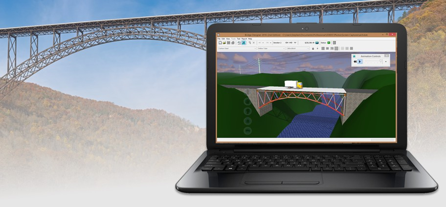

:date: 2018-12-10
:modified: 2026-06-13
:author: Carlos Félix Pardo Martín
:license: Creative Commons Attribution-ShareAlike 4.0 International
:license_url: https://creativecommons.org/licenses/by-sa/4.0/

.. _estructuras-bridge-designer:

Programa Bridge Designer
========================

El programa para diseño de puentes "Bridge Designer" proporciona una
introducción práctica a la ingeniería a través de una experiencia
de diseño auténtica y realista.

Este software proporciona las herramientas para diseñar, probar
y optimizar un puente de acero para autopista, basado en
especificaciones, restricciones y criterios de rendimiento realistas.

Uno de los objetivos del programa es minimizar la cantidad de
material utilizada en la construcción, como corresponde a un criterio
ecológico.

The Bridge Designer es un software para Windows y Mac OS X,
gratuito y de dominio público.
Se proporciona y está destinado únicamente para uso educativo.

Enlaces
-------
* `The Bridge Designer, página principal.
  <http://bridgedesigner.org/>`__
* `Instalador Bridge Designer 1.6 para Windows
  <../_static/downloads/bridge-designer-setup-v16j.exe>`__
* `Bridge Designer, aplicación web 
  <https://app.asce.org/bridge-designer/app/>`__

Tutorial
--------

Tutorial en Inglés de 19 minutos de duración.

* Vídeo: `Bridge Designer 2016 Tutorial.
  <https://www.youtube.com/watch?v=9w9fTC4eh3w>`__

