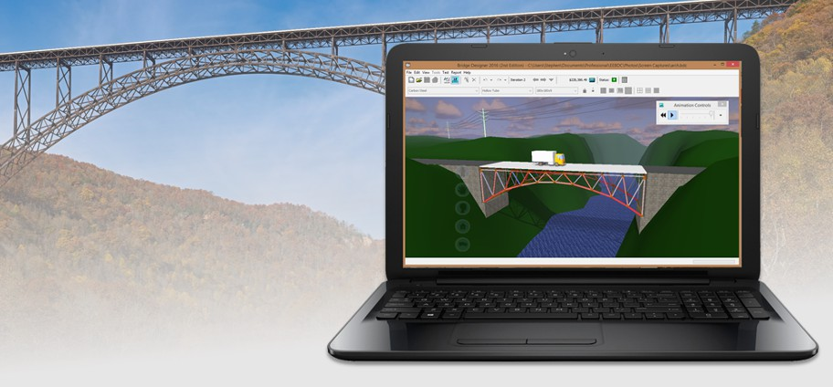

:date: 2026-11-04
:modified: 2026-11-04
:author: Carlos Félix Pardo Martín
:license: Creative Commons Attribution-ShareAlike 4.0 International
:license_url: https://creativecommons.org/licenses/by-sa/4.0/

.. _estructuras-bridge-index:

Bridge Designer
===============
Programa para diseño de puentes "Bridge Designer" que proporciona una
introducción práctica a la ingeniería de diseño de puentes.

.. toctree::
   :numbered: 1
   :maxdepth: 1
   :titlesonly:

   estructuras-bridge-designer.rst
   estructuras-bridge-01.rst
   estructuras-bridge-02.rst
   estructuras-bridge-03.rst
   estructuras-bridge-04.rst
   estructuras-bridge-05.rst
   estructuras-bridge-06.rst
   estructuras-bridge-07.rst
   estructuras-bridge-08.rst
   estructuras-bridge-09.rst
